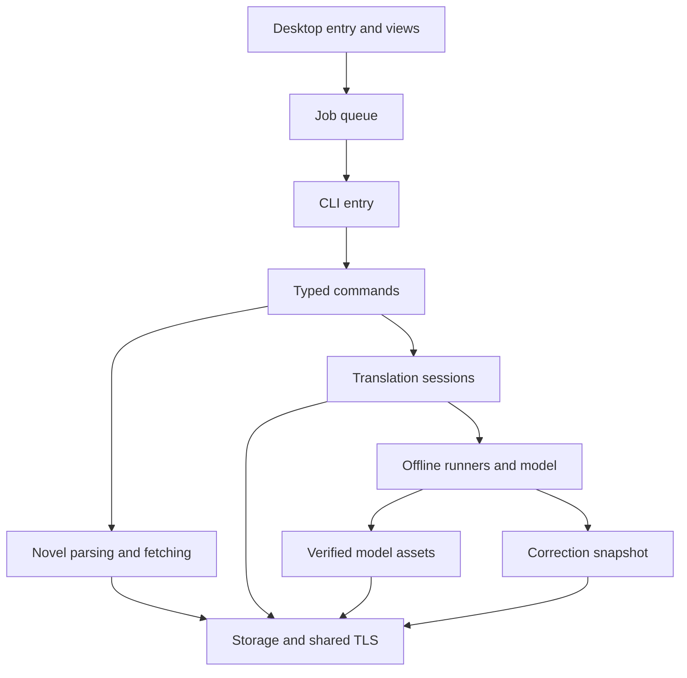

# Rust module boundaries and optimization

The maintained Rust application has thin entry points and a shared library.
Domain modules own their state; frontend code calls their public facades.
The public `config`, `models`, `learning`, `jobs`, `offline`, `int8` and optional
legacy import paths remain available. Model weights and Q8 rounding/scaling are
unchanged. The Candle CPU fork adds batched scheduling, fixed-size register
blocks and scalar-compatible SIMD activation packing.

| Folder | Responsibility |
| --- | --- |
| `src/cli/` | Typed command dispatch, validated arguments, backend construction and command orchestration |
| `src/novel/site/` | URL validation, shared DOM extraction, site adapters, index completeness, chapter parsing |
| `src/novel/network.rs` | Bounded website fetching with the shared TLS client |
| `src/translation/` | Translator trait, backends, filtering, bounded file translation and output formatting |
| `src/translation/filter/` | Literal dictionary parsing, character handling, protected replacements and Korean particle selection |
| `src/translation/session/` | Private session state, subprocess ownership and bounded JSON protocol |
| `src/offline/` | Builder, CPU budget, policy, shared bounded result cache and duplicate batch restoration |
| `src/offline/runner/` | Sentence generation, repetition guard and borrowed-logit selection |
| `src/offline/runner/batched/` | Iteration scheduling, plan pieces, private generation state and ordered completion |
| `src/offline/model/` | Model configuration, transformer layers and isolated CPU operations |
| `src/models/` | Cached manifests, portable discovery, verification and resumable download transport |
| `src/int8/` | Quantized weights and metadata; exporter enabled only by `model-tools` |
| `src/learning/` | Compressed defaults, correction storage, source-qualified terms and dictionary import |
| `src/jobs/` | Desktop queue, process RAII and output/progress event reduction |
| `src/config/` | Application settings and independent Java-properties syntax |
| `src/storage/` | Live translation files, atomic metadata transactions, text decoding and shared SHA-256 |
| `src/legacy/` | Explicitly enabled recovery/compatibility code, outside production builds |
| `src/bin/desktop/` | Desktop state, individual views, widgets and font loading |
| `tools/release_package/src/` | Separate maintainer crate: source validation, model fetching, archive packaging and digest verification |

## Patterns applied

- **Builder and newtype:** `OfflineTranslator::builder(path)` requires the model
  location. `CpuBudget` contains a nonzero budget capped at 64 and available CPUs; policy uses
  `ParallelPolicy`, rather than interchangeable integers/strings inside inference.
  Existing `open`/`open_with_policy` APIs delegate to the same construction path.
- **Ownership and RAII:** `AtomicFile` owns a unique `create_new` temporary file.
  Metadata writes use `commit(self)` to consume the transaction. Translation
  uses `StreamingFile` at the final TXT path: completed source-order rows are
  flushed during inference. An existing file is copied to an exclusively created
  backup before truncation; failure retains the prefix and backup.
  Worker/desktop process guards retain their kill/wait/cleanup behavior.
- **Enums and composition:** commands use exhaustive enum dispatch. Session
  variants are private, so consumers cannot create an empty worker pool.
  Frontend views compose shared configuration, queue and correction services.
- **Borrowing:** greedy decoding scans the existing contiguous CPU logits under
  a storage guard; it does not allocate/copy a vocabulary-sized float vector per
  generated token. Tokenized pieces retain their IDs instead of being encoded twice.
- **Scoped unsafe:** the application denies unsafe code by default. Explicit
  exceptions are the adapted tensor kernels, CPU-gated exact argmax module and
  optional vendor ABI boundaries.
  Both entry points forbid unsafe code.
- **Concurrent state:** workers own attention caches; weights/tokenizer/memory
  snapshots are shared immutably. Up to 64 logical contexts share a bounded Rayon
  compute pool. Result-cache mutation and source-order emission stay with the
  coordinator; progress remains monotonic.

The design follows the [Builder](https://rust-unofficial.github.io/patterns/patterns/creational/builder.html),
[RAII guards](https://rust-unofficial.github.io/patterns/patterns/behavioural/RAII.html),
[newtype](https://rust-unofficial.github.io/patterns/patterns/behavioural/newtype.html)
and [unsafe-boundary guidance](https://doc.rust-lang.org/book/ch20-01-unsafe-rust.html).
These patterns express actual invariants; no training/GPU/framework dependencies
are added for architecture alone. Standard Deflate uses the existing GUI graph's
`miniz_oxide` version, now directly used for compressed correction data.

## Performance and compatibility

- A single 1,024-entry result cache replaces four separate 512-entry caches.
  Oversized entries are excluded. A pending batch translates each unique source
  once, then restores every original position, duplicate and empty line.
  Iteration-level scheduling replaces finished contexts immediately. Independent
  attention/KV state is retained while common projections and FFN are batched.
  A contiguous-prefix sink restores every original slot before live emission.
  The longest-source-first map remains a compatibility fallback.
- Greedy selection preserves finite-score filtering, special-token exclusions,
  repetition bans, total float ordering and the lower-ID tie rule. Membership in
  the repetition set is checked only for a possible new winner.
- Tokenizer decoding uses dense token-ID lookup. Decoder input vectors are reused.
- Site selectors are cached per parsing thread. Static title/filename regular
  expressions and immutable model manifests are initialized once. Non-paginated
  sites avoid an extra DOM parse; first-page embedded data is reused.
- Chapter output is streamed directly to TXT. Text-file translation retains the
  decoded input but only translates/stores 128-line chunks in memory.
- Large correction lists render visible rows. Configuration text fields borrow
  their strings instead of cloning them on every frame. Queue events locate the
  active job once per poll rather than once per log line.

The regression suite checks UTF-8/UTF-16/legacy encoding, final-newline behavior,
bilingual line alignment, failures preserving output, worker initialization,
queue snapshots, TOC completeness, serial/parallel consistency and user edits.
Full-work speed comparison uses pinned INT8, a four-CPU budget, fixed parallel
policy, cached 35-chapter HTML and `--no-learning`; logical contexts vary explicitly.
See [CPU batching](cpu-batching.md) for current measurements and
[the earlier validation record](refactor-validation.md) for v0.3.2 modularization;
source-matched Windows/Linux CI is attached to the PR.

## Default paths and corrections

On Windows, the default download folder is `C:\Users\rabbit\OneDrive\문서`.
An explicit output file or `--output-dir` takes precedence. `download_dir` in
settings overrides the default; the save dialog and automatic filenames use it.
Other platforms retain the current-directory default.

Default correction data is Deflate-compressed into the executable. It contains
60 authored sentence examples, eight reviewed names from the supplied dictionary,
and six source-qualified spelling corrections verified against the pinned model.
An independently compressed 1,058-entry exact-headword core glossary is added
once using a persisted dictionary revision, preserving user overrides/deletions.
There is no initial correction download. Existing user corrections take precedence;
the persisted initialization flag prevents deleted defaults from reappearing.
New profiles use `corrections.json.zlib`; existing JSON profiles remain readable.
`--no-learning` uses an empty correction snapshot. This adaptation is translation
memory, not neural-weight training or a guarantee of fluent output for unseen text.

See [the supplied-resource audit](resource-audit.md) for import scope and exclusions.
